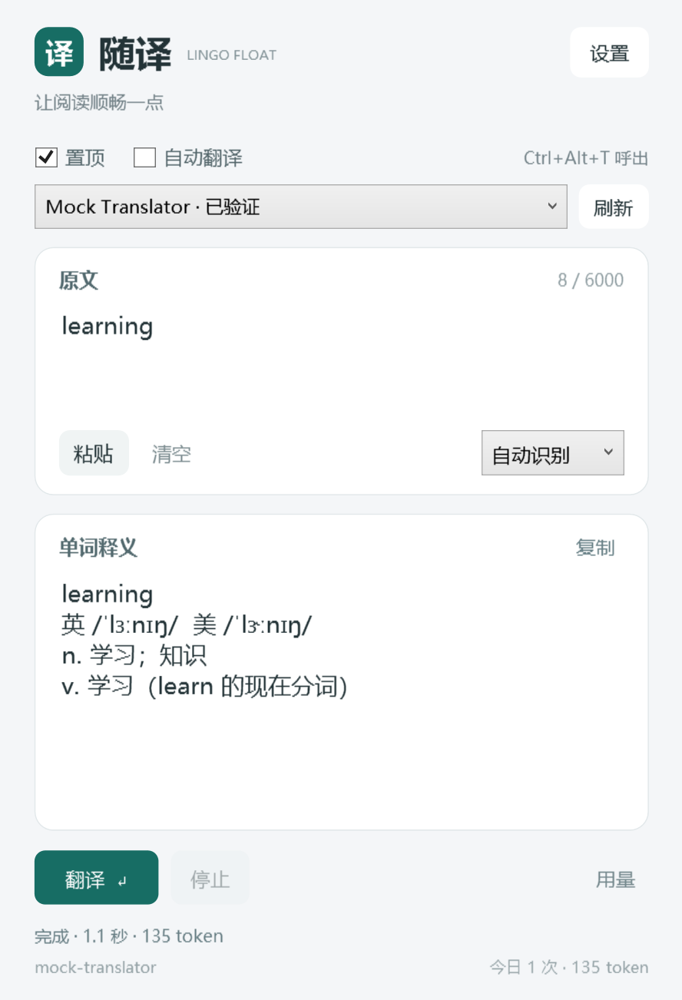

# 随译 · Lingo Float

一个轻巧的 Windows 桌面翻译窗口。阅读外文文档时，粘贴单词、短语或句子，通过自己的模型 API 获取中文结果。

## 功能

- 窗口置顶、自由调整大小，复制后按 `Ctrl+Alt+T` 呼出并查询。
- 粘贴或输入停止 0.8 秒后自动翻译，也可以按 `Ctrl+Enter` 手动提交。
- 单词显示英美音标、词性和简短释义；句子、段落直接翻译成简体中文。
- 流式显示结果，支持停止请求，旧请求不会覆盖新查询。
- 主窗口切换模型，设置中读取模型列表、测试当前模型。
- 支持 OpenAI 兼容 Chat Completions、OpenAI Responses，以及 ClinePass 订阅模型目录。
- Windows DPAPI 加密密钥和本地缓存，缓存最多 200 条；统计应用内记录的 token 用量。



*界面预览使用本地模拟数据，不代表真实模型的翻译效果、用量或延迟。*

## 运行与编译

运行环境：Windows 10/11、.NET Framework 4.8。主程序不需要 Python、Node.js 或浏览器扩展。

在 Windows PowerShell 或 PowerShell 中，从仓库根目录执行：

```powershell
./build.ps1
./bin/LingoFloat.exe
```

编译脚本使用 Windows .NET Framework 自带的 `csc.exe`，无需单独安装 .NET SDK。也可以指定输出目录：

```powershell
./build.ps1 -OutputDir ./release
```

## 配置 API

启动后点击「设置」，填写自己的 API 地址、密钥和完整模型 ID。仓库不提供任何账户密钥或个人配置。

| 服务 | API 地址示例 | 协议 |
| --- | --- | --- |
| OpenAI | `https://api.openai.com/v1` | Chat Completions 或 Responses |
| ClinePass | `https://api.cline.bot/api/v1` | Chat Completions |
| 其他兼容服务商 | 服务商提供的 HTTPS 基础地址 | 按服务商说明选择 |

使用 ClinePass 时勾选「仅显示 ClinePass 订阅模型」，再读取模型列表。订阅目录与按量计费目录分开处理；列表中的新模型显示「未验证」，需要实际调用确认权限与可用性。部分模型强制思考，关闭思考选项仅对已记录兼容的 Cline 模型发送。

兼容服务商若不支持 `max_completion_tokens`，可在高级选项中改为 `max_tokens`；若不支持流式用量参数，可取消相应选项。保存设置本身不调用模型。

## 快捷键

| 快捷键 | 操作 |
| --- | --- |
| `Ctrl+Alt+T` | 查询剪贴板中的文本并呼出窗口 |
| `Ctrl+Enter` | 翻译当前原文 |
| `Esc` | 停止接收当前请求 |

单次原文最多 6000 字符，长文请分段。当前目标语言固定为简体中文；不包含 OCR、朗读或独立词典服务。

## 本机数据

配置、缓存和用量默认位于 `%LOCALAPPDATA%\LingoFloat`。API 密钥和翻译缓存绑定当前 Windows 用户加密保存，不包含在仓库中。翻译时，当前原文会发送给配置的服务商；待机不调用模型。

使用自选数据目录：

```powershell
./bin/LingoFloat.exe --data-dir "D:\LingoFloatData"
```

## 测试

核心和 WPF 界面测试使用仅监听回环地址的模拟 API，不需要真实密钥，不会调用模型服务商。Python 仅用于开发时启动模拟服务；主程序没有 Python 依赖。

先执行 `./build.ps1`，然后在一个终端运行：

```powershell
python -u ./mock_server.py --port-file ./port.txt
```

在另一个终端运行：

```powershell
$fixturePort = Get-Content -LiteralPath ./port.txt -Raw
./test.ps1 -Endpoint ("http://127.0.0.1:" + $fixturePort + "/v1") -DataDir ./test-data
./test-ui.ps1 -Endpoint ("http://127.0.0.1:" + $fixturePort + "/v1") -DataDir ./ui-test-data
```

重复测试请使用新的数据目录。1.1 版本通过 60 项核心检查和 29 项界面检查，涵盖流式解析、取消、缓存、密钥加密、模型目录、切换和设置保存。真实服务商的模型、参数和账户权限需另行验证。

## 项目结构

- `Core.cs`：API 请求、流式解析、模型目录、加密、缓存与用量。
- `App.cs`：窗口事件、快捷键、设置与模型切换。
- `Main.xaml` / `Settings.xaml`：WPF 原生界面。
- `build.ps1`：Windows 编译脚本。
- `Tests.cs` / `UiTests.cs` / `mock_server.py`：本地验证工具。
- `docs/`：使用与开发说明。

更多说明：[使用说明](docs/使用说明.md) · [开发说明](docs/开发说明.md)。
